# Comparing against another checkout

The first scan of a long-lived model can report hundreds of findings, which makes a
CI gate on it red from day one. `--compare-root` gates on what a change *introduces*
instead (issue #141): ripbi reruns the same scan in another checkout of the project,
such as the pull request's base branch, and reports only the findings that did not
exist there.

```sh
git worktree add ../base origin/main
ripbi scan --compare-root ../base
```



- **The same scan, twice.** The other side gets the same PATH, `--model`, `--report`,
  and flags. Relative paths are rebased onto `DIR`, so `ripbi scan Sales.pbip
  --compare-root ../base` compares `Sales.pbip` with `../base/Sales.pbip`. Absolute
  paths are used unchanged on both sides, for example a shared report folder outside
  the repository. Discovery runs in `DIR`, and `DIR`'s own `ripbi.toml` applies there.
  Every connected report is compared on both sides, so a change that removes a
  report's last binding to a measure makes that measure a new finding.
- **Git is not required.** ripbi compares two folders. How the other checkout gets
  there is up to the pipeline: `git worktree`, a second clone, or a previous
  release's `.pbix` stored at the same relative path.
- **Matching.** A finding matches by kind and display id, compared
  case-insensitively like the engine compares names. A broken binding also matches on
  its reason and binding site, a report-level broken artifact on its report item's
  name, and an auto date/time table on its verdict. File paths are never compared,
  so the two checkouts can live anywhere. A renamed object reads as one new finding
  plus one fixed.
- **Existing findings** count every finding the other checkout's scan *detected*,
  including ones its `[scan].ignore` or `--type` hid. So a finding is new only when it
  truly did not exist there, and this checkout's own filters decide what is reported.
  Existing findings are left out of every output mode and the exit code, like
  `[scan].ignore` suppressions. The human modes count them under the summary line:
  `(412 findings already in ../base)`. A dead auto date/time table's own finding goes
  with its row. `--compare-label main` makes that `already in main`, here and in
  every other output that names the checkout, for a CI run that knows which branch
  it holds.
- **Fixed findings** are the other checkout's findings this scan no longer detects at
  all, whether reported, ignored, filtered, or suppressed. A finding hidden by `--type`
  is still detected, so it is not fixed. Human output lists them in a
  `Fixed since <DIR> (N)` section at the end, `--summary` counts them, `--plain`
  prints one `fixed:<type>\t<id>` record each, and `--json` lists them under
  `compare.fixed`. Fixed findings never fail the run. When this scan's ingest
  recorded an `unknown_object` skip notice, a finding may have vanished because its
  object failed to parse rather than because it was removed: the list then carries a
  caveat, and `compare.fixed_uncertain` is `true`.
- **Baseline coverage.** Every comparison records how far the other checkout's scan
  can be trusted, as `compare.baseline` in `--json`:
  - `scanned`: the scan ran there against connected reports, and every finding
    compares as described above.
  - `skipped`: the model was there, but no report was connected to it (or only
    `stub-report` stubs), typically because this change connects the model's
    first report. Usage was never checked there, so the comparison does not read
    that as "zero findings". A `! baseline skipped in …` note on stderr says so,
    with or without `--allow-no-reports`. Objects still compare by identity:
    - An unused object (or a not-in-use auto date/time table) **this change adds**
      did not exist there, so it is new, reported, and gates as usual.
    - An unused object that **already existed** there is **unverified**: left out
      of the findings and of the exit code, and never "fixed". The human modes
      count them under the summary line: `(118 unused unverified — no connected
      reports in main, …)`. `--plain` prints one `unverified:<type>\t<id>` record
      each, `--json` lists them under `compare.unverified`, and the Markdown
      summary opens with a **Baseline skipped** note. SARIF leaves them out of
      `results` and records the gap as a run-level
      `invocations[0].toolExecutionNotifications` warning.
    - Breakage (`broken_visual`, `broken_artifact`) does not depend on usage and
      compares exactly.
  - `unavailable`: the scan could not run in `DIR` at all (a model this change
    adds, say). A `! nothing to compare in …` note on stderr says why, and every
    finding is new. SARIF records it as a run-level notification too.

  Exit codes follow the reported findings only. Unverified findings never fail the
  run, and incomplete coverage is not a skip notice, so `--strict` does not gate
  on it either. Once the change merges, the base branch has a connected report,
  and the next comparison is `scanned` again. Until then, an object that is
  unused for real gets the same answer as any finding: remove it, or keep it with
  `ripbi_keep`.
- A `DIR` that is not a folder is exit `2`.
- **The keep hint.** When new unused objects are reported, every mode but `--json`
  ends with a `hint:` on stderr pointing at the `ripbi_keep` annotation, the answer
  for an object a consumer ripbi cannot see reads.

## In CI

The [ripbi GitHub Action](https://github.com/bgarcevic/ripbi/tree/main/ci/github-action)
and the Azure Pipelines template
([`templates/ripbi-scan.yml`](https://github.com/bgarcevic/ripbi/blob/main/templates/ripbi-scan.yml))
do all of this on pull requests: they check out the target branch beside the
repository, compare, annotate the new findings, and fail only on them. See
[CI in five minutes](https://bgarcevic.github.io/ripbi/ci.html).

By hand, the target branch needs no history, only its files:

```sh
git fetch --depth=1 origin main
git worktree add ../base FETCH_HEAD
rib scan --compare-root ../base
```

Accepting a finding means merging the change: once it is on the base branch, the next
pull request compares against it. An object meant to stay unused on purpose — a measure
only an Excel pivot reads — gets a `ripbi_keep` annotation instead; see
[Keeping objects on purpose](keep.md).
