# Human output (default)

What `ripbi scan` prints when no output flag is passed.



```text
AdventureWorks Sales.SemanticModel · 1 report

Measures (11)
  'Sales'[Average Sales per Order]
    ← nothing references it
Columns (28)
  'Customer'[City]
    ← only used by hierarchy 'Customer'[Geography] — hierarchy level (also unused)
  'Customer'[Customer ID]
    ← nothing references it

✗ 56 unused objects   74 of 130 reachable from 51 roots
  check thin reports, Excel and XMLA clients before removing; ripbi can't see them
```

The output reads in three tiers, most important last, because the last line is the
one a terminal leaves in view:

- **Header and notes** (stderr). The model's name and its report count, then one
  indented line per note: `!` for a note that changes how to read the result (stale or
  partial stats, a by-name pairing, a failed comparison base), `·` for background (a
  query log in use, reports bound to other models, a ripbi stub). Full paths and notes
  that only confirm the expected case (complete stats coverage) wait for `--verbose`.
- **Findings and sections** (stdout), described below.
- **The verdict** (stdout), last: `✓ No unused objects` or `✗ 56 unused objects`, then
  how many objects reachability reached, out of the total, from how many report
  binding roots. Roots are report bindings — the desktop tree and the phone layout
  (`definition.mobile/`, issue #49) alike; RLS roles also seed reachability without
  counting here. On a terminal the scan's wall time closes the line. Indented under it:
  the `Unused storage:` total ([Storage sizes](storage.md)); a line for objects
  `[scan].ignore` suppressed; one for findings the type selection hid
  (`(2 unused hidden by type filters)`); and one for auto date/time machinery members
  covered by the section's table verdicts, so `No unused objects` from a filtered or
  machinery-heavy model never reads as a clean one by accident.
- **The consumer hint** (stderr), under a verdict with findings only: ripbi sees the
  ingested reports, not thin reports in other workspaces, Analyze in Excel, or XMLA
  clients, so a finding is a candidate until those are checked. With a query log it
  names the consumers outside the log's window instead; with an Excel workbook among
  the reports it says `other Excel workbooks`, since the ones passed are read. A clean scan has nothing to
  remove and prints no hint; `[scan].external_consumers = "none"` in
  [`ripbi.toml`](../config.md) drops it for a model nothing else reads.
- Findings are grouped by object type (measures, columns, hierarchies, tables,
  partitions, relationships, calculation items, expressions, functions, report
  measures, bookmarks — fixed order, empty groups omitted), sorted by object identity. The type
  flags restrict the groups to the selected kinds; empty groups are still never printed.
- Chain annotations, one per referencing object:
  - `← nothing references it` — a true orphan, deletable outright;
  - `← only used by 'X' — <where> (also unused)` — the sole (or all-identical case:
    every) consumer is itself unused, so the whole chain can go;
  - `← used by 'X' — <where>` — the consumer is live but its use could not keep this
    object alive (a key column held only by an active relationship endpoint, or the
    table of an inactive relationship nothing activates).
- The `⭘ Power Query also names it (…)` annotation appears, behind `--power-query`,
  on Data columns named by M expressions. With the flag, the last finding above
  reads:

  ```text
    'Customer'[Customer ID]
      ← nothing references it
      ⭘ Power Query also names it ('Customer' partition) — safe to stop loading; removing it from the script means editing those steps too
  ```

  It is supply-chain context, not a consumer:
  unloading the column cannot break refresh, but removing it from the Power Query
  script *entirely* means editing each named partition or expression too — cleanup-time
  guidance, so it is hidden by default and shown only on request. Columns without the
  annotation are also gone from every Power Query step — and engine-computed columns
  (calculated columns, auto date/time machinery) never carry it, because an M step can
  only name a column it produces. `--json` always carries the underlying
  `named_in_power_query` field regardless of the flag.
- The **Broken artifacts** section follows unused findings (issue #84): one row per
  DAX owner with unresolved field references, whether or not a visual binds it.
  Indented lines list the distinct written references. Report-level measures
  include their report path; model objects have no report path. Several broken
  properties of one object still produce one row. M expressions are not checked.
  The section is advisory unless `--broken` is selected.
- The **Broken visual bindings** section follows the artifact section (issue #60): one row per
  report binding whose written field reference resolves to nothing in the model, or
  that lands on an artifact whose own DAX no longer resolves — the static form of the
  error state the service would render. Each row names the written reference, the
  reason, and the binding's site as Power BI Desktop shows it — the visual's type
  and literal title, the page's tab name — with the generated IDs in parentheses
  for finding the PBIR folder. A visual without a literal title (an auto-generated
  or measure-bound one) is named by its ID:

  ```text
  Broken visual bindings (2)
    'Sales'[Color]
      ← field not found in the model — field well 'Values' — card visual 'Colors sold' (id 'V2') on page 'Overview' (id 'P1')
    'Sales'[Broken Total]
      ← bound artifact 'Sales'[Broken Total] has unresolvable references — field well 'Values' — card visual 'V3' on page 'Overview' (id 'P1')
  ```

  The section is a different verdict than reachability's — written references, not
  graph liveness — so it prints even on an otherwise clean `No unused objects` scan,
  and it is *advisory*: it never changes the exit code unless `--broken` selects it.
  Under a lone `--broken`, the findings list is empty by construction — the flag scopes
  the run to breakage — so the verdict names that scope instead:
  `✓ No broken reports or artifacts` when nothing flags, `✗ 3 broken bindings` when either
  breakage section has rows. Every other selection keeps the unused verdict. Hidden bindings (a type
  flag without `--broken`) and suppressed ones are accounted
  for in the summary's arithmetic lines: `(2 broken-visual bindings hidden by type
  filters)` and `(N possible broken-visual bindings suppressed — the model ingest
  reported skips, listed on stderr; --strict fails on those skips)`. Artifact
  findings have corresponding hidden and suppressed counts.

  The **precision bar is the mirror image of the unused findings'**: a "broken" claim
  is itself a breakage claim, so it fires only when nothing in the model ingest could
  have hidden the name the binding wrote. That is exactly the `unknown_object` skip
  kind — a table or column the parser skipped never became a node, so a "field not
  found" verdict would be a guess — and only that kind: an `unknown_property` notice
  means the object was parsed with its name regardless, so it does not suppress. The
  suppressed count rides on the summary line, and `--strict` surfaces the skips behind
  it. Report-side skips do not suppress either way: a half-parsed
  report can only under-report breakage, never fabricate it. The remaining
  under-claiming is deliberate:

  - a KPI visual's synthesized variants (`… Goal`, `… Status`, `… Trend`, `… Value`)
    resolve, not flag, whenever the base measure exists — the engine materializes them;
  - an artifact's own DAX resolving through query-time constructs never flags: a
    report measure referencing a sibling report measure (the graph's ordinary
    report-measure edge), `@`-prefixed extension columns (`ADDCOLUMNS(…, "@Krav", …)`
    read back as `[@Krav]`), and the column names query time introduces in the same
    expression — string-literal extension names (`SELECTCOLUMNS(t, "Ordning", …)`,
    `GROUPBY`) and the table constructor's fixed `Value`/`Value1…N` defaults.
    Verifying these needs DAX scope analysis the lexer deliberately does not do, so
    under-claim applies; the cost is that a typo coinciding with a string in the same
    measure goes unflagged;
  - a qualified field miss on a **calculated table** resolves when the partition
    expression makes the name lexically visible: string literals (`DATATABLE` headers,
    `ADDCOLUMNS`/`SELECTCOLUMNS` names), the constructor defaults, the columns written
    in the expression, and every column of the tables it references (the wrapped-table
    shape `FILTER`/`VALUES` passes through). A calculated table has no declared schema —
    its columns are what the expression returns — so only names visible *nowhere* in
    the expression flag; renaming a header out from under a binding still does;
  - field parameters resolve like any other field (#52), and auto date/time hierarchy
    references resolve through the variation machinery (#47); a variation-flavored
    hierarchy the machinery cannot resolve stays silent rather than risk calling
    serialization drift a breakage;
  - a measure referenced through a stale or wrong table qualifier still resolves
    (measure names are model-global), and a same-named hierarchy or calculation item
    behind a stale column name resolves too;
  - `Written` references the parser could not structure (legacy layouts, unresolved
    query aliases) resolve as always but never flag — the written form is too loose
    for a breakage claim;
  - a **Fabric app** is checked only inside a DAX string literal with at least one
    reference that still resolves (a query against this model, not a label or a CSS
    selector like `[data-id]`), and reports at `code at <file>:<line>`. A name any
    of the app's DAX strings introduces (`"Total"`, read back as `[Total]`) resolves
    anywhere in the app, because a query is split across literals at its `${…}`
    interpolations; a literal in which nothing resolves any more is not reported.

  Bookmarks on deleted pages never reach this check: their sections are skipped as
  stale at ingestion. The phone layout binds identically to the desktop tree, so a
  broken binding there reports with `mobile layout …` provenance. A binding onto a
  broken artifact still counts as a root (it resolves — that is what it does), so the
  artifact itself is not reported unused by it; its own broken-artifact finding
  appears independently, whether or not a visual binds it.
- The **Auto date/time** section follows the findings: one verdict per
  `LocalDateTable_*`/`DateTableTemplate_*` table, naming the user's date column the
  machinery serves. It is a *provenance* verdict, not a reachability one — the engine's
  own relationship keeps the machinery alive, so "alive" says nothing. The section is
  table-shaped: it prints (and carries its exit-code weight) only when no type selection is
  passed or `--type table` is among it; hidden, it is absent from every output mode.
  - `in use — replace with a real date table` — a report binding lands on the
    machinery (usually a visual's date hierarchy over the varied column). Informational;
    it never fails the exit code.
  - `unused by reports — disable auto date/time` — nothing binds it, yet reachability
    keeps it alive: pure bloat the findings list cannot express, because the object is
    not dead.
  - `dead` — nothing reaches it at all; the table's own finding (with its chain
    annotations) is filed here instead of the generic `Tables` group.

  The section is also the only place the machinery appears (issue #47): its unused
  members — the GUID-named columns, hierarchies, and partitions under those tables —
  are never generic findings, because they are not separately actionable. Removing the
  table removes them, and disabling auto date/time on the named column is the fix; the
  summary line accounts for them (`(41 unused auto date/time members covered by their
  tables' verdicts)`), and `--json` reports the count as
  `summary.auto_date_time.member_findings`.
- Auto date/time is a recommendation, not a law: a legacy model that keeps the feature
  can silence the section through the ordinary `[scan].ignore` globs —

  ```toml
  [scan]
  ignore = ["LocalDateTable_*", "DateTableTemplate_*"]
  ```

  Suppressed tables count as handled, so they cannot fail the exit code, and a dead
  table's own finding — suppressed with its row — counts in `summary.ignored`. The
  trade-off: the recipe also hides the
  `in use` tables' advice, which is the part worth reading when you plan the migration
  to a real date table.
