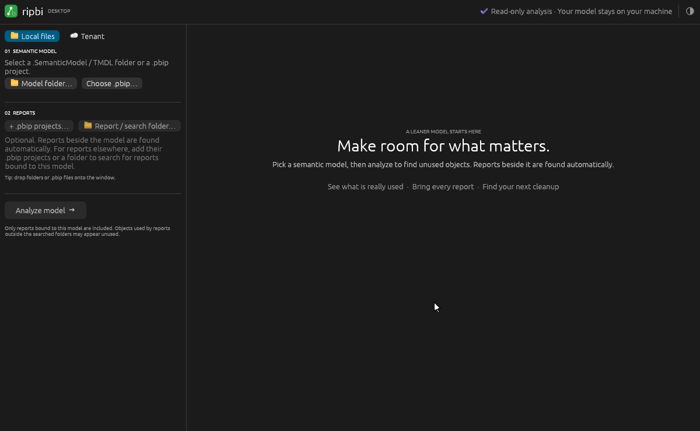

# ripbi desktop (egui, experimental)

An exploration of a pure-Rust desktop UI for ripbi using [egui](https://github.com/emilk/egui)
(`eframe`). No Node.js, no WebView: one native binary.



`src/demo.rs` records this GIF headlessly; see its header to re-record it
after a UI change.

## Run

Each release attaches `ripbi-desktop-<version>-<target>` archives for Windows,
macOS (Apple silicon) and Linux; see the release notes. From source:

```sh
cargo run --manifest-path desktop-egui/Cargo.toml
```

1. Pick a `.SemanticModel` / TMDL folder or a `.pbip` project (or drop it on the window).
2. Add `.pbip` projects, `.Report` folders, or search folders (or drop them).
3. Analyze, then browse unused objects, broken references, date tables, and coverage.
   Export JSON writes `{ result, diagnostics }`.
4. **Inventory** lists everything the analysis read, two ways round.
   *Model → reports* lists tables and their members; expand an object to see
   the visuals it reaches, directly or through what uses it. *Reports → model*
   lists pages and visuals; expand a visual to its fields, and a field on
   through what it uses. Filter either, or show unused objects only; select an
   object to see what it uses, what uses it, and where reports bind it.
5. **Lineage** draws one object's dependencies as a graph: what it uses on the
   left, what uses it on the right, out to the report visuals. Pick the object
   from the inventory beside it (Objects hides it to widen the graph), search
   for it, or choose "Show lineage" on an unused one or in Inventory (or
   double-click its row); click any node to move the focus there.

Or switch to **Tenant**: paste a link to a model or report (or name the
workspace and model, or leave both blank to pick from lists), choose a folder, and
Fetch & analyze. This is `ripbi fetch --scan`: it signs in (Azure CLI, a token, or a
service principal; see the CLI's `--auth`), shows the downstream forecast, asks before
downloading an incomplete report set, writes the project, and analyzes it.

Release builds update themselves, like `ripbi update`: `src/update.rs` checks
GitHub for a newer release, downloads and verifies (sha256) its archive in the
background, and a card in the bottom-left corner offers "Restart to update".
Builds from source never update; `RIPBI_NO_UPDATE_CHECK` turns the check off.

The header's theme icon cycles through system, light and dark.
The choice, like the window size, is remembered across runs.

## Design

`src/analysis.rs` calls `ripbi_app::scan::run` on a worker thread: the same
pipeline `ripbi scan` runs, with a typed `ScanRequest` in and a typed
`ScanOutput` out — no CLI crate, no JSON round-trip. Its notes are collected
for the coverage tab, and Export JSON writes `ripbi_app::json` (schema v1,
exactly what `ripbi scan --json` prints) under `result`.
`src/fetching.rs` runs `ripbi_app::fetch::run` on a worker thread; the fetch's
questions (workspace and model pickers, the incomplete-set confirmation) arrive
as events and block the worker until the UI answers from a modal.
`src/lineage.rs` loads `ripbi_app::deps::load` once per analysis (the graph
`ripbi deps` explores), asks its `Explorer` for each focused view, and lays the
slices out in columns by edge distance, painted with egui's painter.
`src/inventory.rs` builds the object tree from the same `Explorer` (on the
same worker): objects grouped by table, report bindings grouped by report,
page and visual, and for every object the visuals that reach it.
`src/main.rs` is the immediate-mode UI. The package is
standalone (its own `[workspace]` and `Cargo.lock`) so GUI dependencies stay
out of CLI builds; `.github/workflows/desktop.yml` checks it on Windows, macOS
and Linux in CI and packages it on release.

```sh
cargo clippy --manifest-path desktop-egui/Cargo.toml --all-targets -- -D warnings
cargo test --manifest-path desktop-egui/Cargo.toml
```

## Icon

`src/brand.rs` defines the mark once. It paints the header logo and the
running window's icon, and its tests generate the files each platform reads
from disk into `assets/`. Change the geometry, then regenerate:

```sh
RIPBI_WRITE_ICONS=1 cargo test --manifest-path desktop-egui/Cargo.toml
```

- **Windows**: `build.rs` embeds `assets/ripbi.ico` in the exe (via `windres` or
  `rc.exe`), so Explorer, shortcuts and the taskbar show it.
- **macOS**: a bare binary has no icon; the release workflow wraps it in
  `ripbi.app` with `assets/ripbi.icns`. Locally, `cargo bundle --release`
  (cargo-bundle) does the same.
- **Linux**: copy `assets/ripbi.png` to
  `~/.local/share/icons/hicolor/256x256/apps/` and `assets/ripbi.desktop` to
  `~/.local/share/applications/`; the window's app id `ripbi` ties them together.
